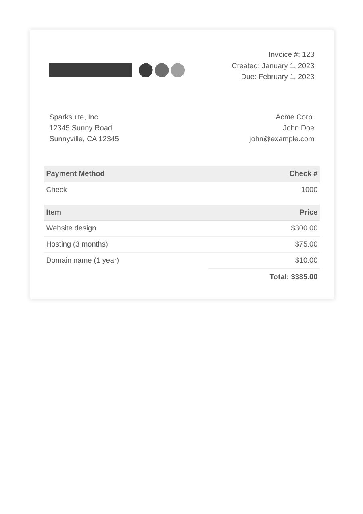
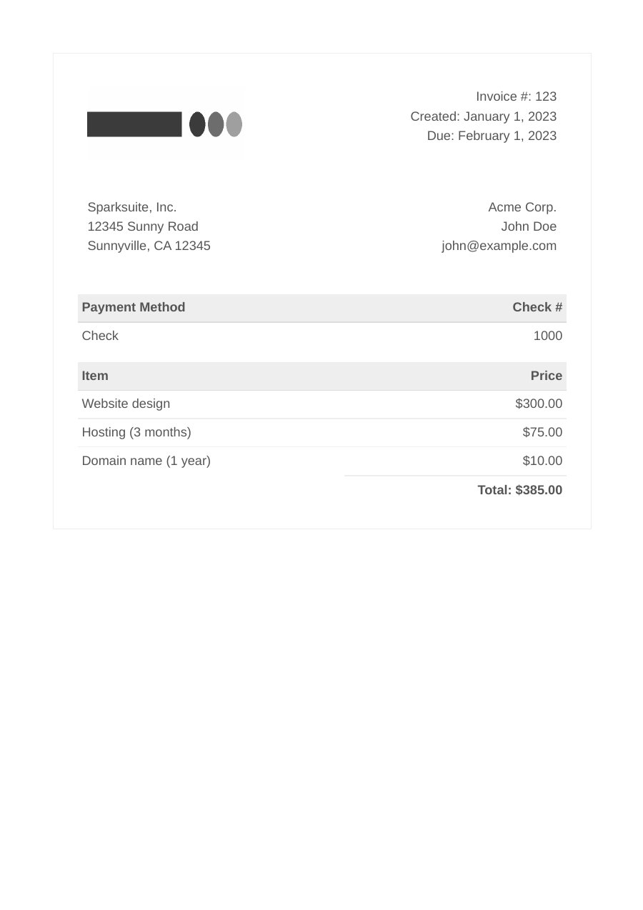

# vellora

**HTML to PDF in Node.js. No Chromium. No Puppeteer.**

[](https://github.com/diomalta/vellora/actions/workflows/ci.yml)
[](https://www.npmjs.com/package/vellora)


Turn the HTML templates you already have (invoices, receipts, statements) into PDFs with one
function call inside Node.js. No browser to install, launch, sandbox or patch.

<table>
  <tr>
    <th>Chrome print-to-PDF</th>
    <th>vellora 0.3.0</th>
  </tr>
  <tr>
    <td></td>
    <td></td>
  </tr>
</table>

<sub>Same HTML, two PDFs: an open-source invoice template, page 1. Left: Chrome for Testing 155. Right: vellora 0.3.0, with no browser installed.</sub>

## Install

```bash
npm install vellora
```

Prebuilt for macOS (arm64, x64) and Linux with glibc (x64, arm64), on Node.js 20 or later. No
Rust, Python, Chromium or system fonts needed. No Windows or Alpine/musl builds.

## Your first PDF

```js
import { writeFileSync } from "node:fs";
import { renderPdf } from "vellora";

const html = "<h1>Receipt for {{ name }}</h1><p>Total: {{ total | currency('USD') }}</p>";
const pdf = await renderPdf(html, { name: "Ada", total: 42 });
writeFileSync("receipt.pdf", pdf);
```

`renderPdf` returns the PDF as a `Uint8Array`. Your HTML is always treated as a template
(`{{ value }}`, ``, ``, and `currency`, `number` and `date` helpers), so a literal
`{{` or `{%` in pre-rendered HTML is read as template syntax. Put CSS in a `<style>` tag or
`style=""`: vellora loads nothing from the network, so `<link rel="stylesheet">` and `@import` are
ignored, and images and fonts are passed in as bytes.

## Why not just use Puppeteer?

Printing a PDF with Puppeteer means shipping and looking after a browser:

| The browser way | With vellora |
|---|---|
| A Chromium download in every image, plus the shared libraries it needs | One npm package with a prebuilt native addon: a 39.72 MB fresh install |
| Sandbox flags and launch errors in Docker | Nothing to launch: the PDF is laid out inside your Node process |
| A browser process to keep warm, restart and patch | One async call; a warm 3-page invoice renders in about 19 ms |
| Fonts that change between your laptop and the server | The same bundled fonts on every machine; no surprise font swaps |
| CSS it can't handle shows up as a broken PDF | Unsupported CSS fails before any PDF is written, with the line and column |

The timings and sizes come from our benchmark on a GitHub Actions Linux runner; see
[Performance](#performance).

When vellora meets something it can't draw faithfully, it tells you where. Rendering
`<p style="transform: rotate(5deg)">Total</p>` throws:

```text
VelloraUnsupportedError: Unsupported construct "css:transform" at line 1, column 11: this CSS feature is outside vellora's document subset; run `vellora fix`
```

<sub>The `vellora fix` and `vellora doctor` commands need `@vellora/cli` 0.3.2, the next release; the installed command in 0.3.0 exits without output.</sub>

## Is it a fit?

**Good fit:** documents you generate from templates you control. Invoices, receipts, statements,
reports, letters, notices, bank slips. Tables that span pages with a repeated header, page
numbers, inline SVG, your own fonts and images, PDF/A-2b for archiving.

**Works with limits:** `display: flex` is partial (tables are the reliable choice for layout).
Floats and multi-column text work, with documented edge cases; a multi-column container taller
than a page is not split across pages.

**Not a fit:** arbitrary web pages, pages that need JavaScript to build their content, CSS grid,
transforms, animations, forms and `<canvas>`. vellora rejects those instead of guessing. For the
few templates that need them, the optional [Chromium engine](#when-to-use-the-optional-chromium-engine)
renders through Chrome while everything else stays native.

Not sure about your template? [Will my template work?](https://diomalta.github.io/vellora/compatibility)
walks through it.

## Measured fidelity

We measure how close vellora's PDF lands to Chrome's print-to-PDF for the same HTML, word by
word, on the documents we test. Most of them match closely; one is not perfect yet. The picture
below shows the same page three times. Left: Chrome. Middle: our previous release. Right:
vellora 0.3.0.

<!-- fidelity-evidence:readme-hero -->


| Measured against Chrome for Testing 155 print-to-PDF, 9 document fixtures | vellora 0.2.0 | vellora 0.3.0 |
|---|---:|---:|
| Fixtures with every word within 1 mm of Chrome's position | 0 of 9 | 8 of 9 |
| Largest per-fixture median word-position error | 106.22 mm | 0.21 mm |
| Fixtures that print the same number of pages as Chrome | 6 of 9 | 9 of 9 |
| WPT reftests passed (CSS subset coverage, not a quality score) | 2,578 of 8,047 | 4,553 of 8,047 |

<sub>Released in vellora 0.3.0; indicative local macOS measurement. Source: [manifest.json](./docs/assets/fidelity/manifest.json), method in [Measured fidelity](#measured-fidelity).</sub>
<!-- /fidelity-evidence:readme-hero -->

Known gaps: a multi-column container taller than a page is not split across pages, and `outline`
is not painted ([issue #52](https://github.com/diomalta/vellora/issues/52)). Every loss is listed
in [How close is vellora to Chrome?](https://diomalta.github.io/vellora/guide/fidelity#measured-fidelity),
and per-feature caveats are in [COMPATIBILITY.md](./COMPATIBILITY.md). To check your own
templates, run `vellora doctor` (from `@vellora/cli` 0.3.2, the next release).

## Performance

A warm render of a 3-page invoice takes 19.09 ms at the median and 23.32 ms for the slowest 1 in
20 renders. With 8 renders at once, the whole Node process peaks at 117.60 MB of memory.

| Path | Fresh install | Native addon (linux-x64-gnu) | Browser binary | Memory @8 concurrent | Cold start | Warm median / slowest 1 in 20 |
|---|---:|---:|---:|---:|---:|---:|
| `vellora` (native, default) | 39.72 MB | 33.77 MB | none | 117.60 MB (whole Node process) | 47.29 ms | 19.09 / 23.32 ms |
| vellora's optional Chromium engine (launches Chromium per render) | 39.74 MB | 33.77 MB | 412.28 MB | 6833.96 MB (summed across Chromium processes) | 735.01 ms | 635.50 / 681.03 ms |

<sub>GitHub Actions Linux runner (AMD EPYC 7763, 4 cores, Node v22.23.4), [run 40687532121](https://github.com/diomalta/vellora/actions/runs/40687532121), built from the v0.3.0 commit; warm timings over 50 renders. The two memory figures are sampled differently, and summing memory across browser processes counts shared memory more than once.</sub>

<details>
<summary>More about these numbers</summary>

Puppeteer and Playwright were measured too but are not quoted: the run marks them not comparable
for this fixture (page count 1 instead of 3). Install size grew in 0.3.0; the release notes
attribute it to inline SVG support. Method and harness: [benchmarks/](./benchmarks/).

</details>

## Supported HTML and CSS

vellora is not a browser. It targets generated documents whose markup you control. The full,
generated reference is [COMPATIBILITY.md](./COMPATIBILITY.md); in short:

- Block and inline text, headings and lists; tables, including repeated `<thead>` across pages,
  table captions and anonymous table boxes.
- `@page` size and margins, `counter(page)` / `counter(pages)`, running headers and footers in
  `@top-center` and `@bottom-center`, `@page :first` / `:left` / `:right`, named pages (page breaks only; named `@page` rules are not
  applied yet).
- `break-inside: avoid`, `break-before` and `break-after` (and the legacy `page-break-*` forms).
- Floats, multi-column layout (`columns`, `column-count`, `column-width`, `column-gap`,
  `column-fill`) and ruby annotations, each with the partial-support caveats listed in
  COMPATIBILITY.md.
- Inline `<svg>` as PDF vector content, with `<text>` set in the bundled or supplied fonts.
- PNG, JPEG, GIF and WebP images from data URLs or the `images` option; custom TTF/OTF faces from
  the `fonts` option.
- Selectable text with embedded font subsets, document metadata, and PDF/A-2b output.
- `display: flex` is accepted but partial; prefer tables for layout you rely on.

Rejected by default (strict mode): JavaScript and `<script>`, form controls, `<canvas>`, media,
`<iframe>` / `<object>` / `<embed>`, `transform`, `filter`, `animation`, `transition`,
`display: grid` (`vellora fix` converts the common table-cell case), and `@page` margin boxes
other than top-center and bottom-center. Strict mode never changes your HTML; `{ strict: false }`
applies the automatic fixes from `@vellora/lint` before rendering.

The same input gives the same PDF bytes on the same platform: no clock (an omitted creation date
is a fixed constant), no randomness, no host fonts. In our cross-OS check on a pre-release 0.3.0
tree, macOS arm64 and Linux arm64 produced identical bytes; x86_64 was not measured.

## When to use the optional Chromium engine

Use `engine: "chromium"` for a template that needs something vellora does not draw, such as
JavaScript, CSS grid, transforms or arbitrary web pages, or whose PDF must come from Chrome's own
print path. It launches a Chrome/Chromium executable you provide, with headless print-to-PDF, and
does not depend on Puppeteer or Playwright.

```bash
npm install vellora @vellora/engine-chromium
```

```ts
const pdf = await renderPdf(html, data, {
  engine: "chromium",
  chromium: { executablePath: "/path/to/chrome", timeoutMs: 30_000 },
});
```

`engine: "auto"` routes each template by a committed `vellora.fidelity.json` policy, so one
service can keep most templates native and send the rest to Chromium. See
[When you need Chrome](https://diomalta.github.io/vellora/guide/chromium-engine).

## Using from CommonJS

vellora ships as ESM. CommonJS projects (for example NestJS with `"module": "commonjs"`) can
`require("vellora")` on Node 20.19+ or 22.12+, where Node loads ES modules through `require()`. On
older Node versions, use `await import("vellora")` instead. In CommonJS:

- Use named imports (`import { renderPdf } from "vellora"`). The package has no default export.
- With TypeScript `moduleResolution: "node16"`, a CommonJS file cannot import vellora (TS1479).
  Use `"nodenext"` or `"node20"` (TypeScript 5.8+), or the classic `"node"` resolution.
- When bundling to CommonJS (esbuild, webpack), mark `vellora` and `@vellora/*` as externals. The
  native loader needs `import.meta.url`, which a CommonJS bundle does not provide.
- Node 22.12 prints a harmless `ExperimentalWarning` on `require()` of an ES module; later 22.x
  releases do not.

## Under the hood

`renderPdf()` lays out and writes the PDF inside your Node.js process: Blitz for layout, krilla
for PDF output, behind one async call on the libuv thread pool, through a napi-rs addon. Details
in [ARCHITECTURE.md](./ARCHITECTURE.md).

| Package | Purpose |
|---|---|
| `vellora` | Public API (`renderPdf`, `renderPdfBatch`, `renderPdfToStream`), templating, orchestration |
| `@vellora/native` | The prebuilt native renderer for your platform. Installed for you. |
| `@vellora/lint` | Dev-time `diagnose()` and `fix()`; never on the strict render path |
| `@vellora/cli` | `vellora render`, `lint`, `fix`, `doctor` and `fidelity` |
| `@vellora/engine-chromium` | Optional browser engine using a host-supplied Chrome/Chromium |

## What's new in 0.3.0

Floats, multi-column layout, ruby annotations, `break-before` / `break-after`, tables split
across pages with captions, inline `<svg>` drawn as PDF vectors, page backgrounds and dashed or
dotted borders. The layout engine underneath (Blitz) moved to its 0.3.0-beta.4 release. Full
notes: [GitHub Release v0.3.0](https://github.com/diomalta/vellora/releases/tag/v0.3.0) and
[CHANGELOG.md](./CHANGELOG.md).

## Docs

- [Docs site](https://diomalta.github.io/vellora/)
- [Your first PDF in three steps](https://diomalta.github.io/vellora/guide/getting-started)
- [Switching from Puppeteer](https://diomalta.github.io/vellora/migrating)
- [Will my template work?](https://diomalta.github.io/vellora/compatibility)
- [How close is vellora to Chrome?](https://diomalta.github.io/vellora/guide/fidelity)
- [Examples](https://diomalta.github.io/vellora/recipes)
- Blog: [HTML to PDF in Node.js without Puppeteer or Chromium](https://diomalta.github.io/vellora/blog/html-to-pdf-nodejs-without-puppeteer)
- [COMPATIBILITY.md](./COMPATIBILITY.md) · [ARCHITECTURE.md](./ARCHITECTURE.md) ·
  [benchmarks/](./benchmarks/) · [RELEASING.md](./RELEASING.md) · [SECURITY.md](./SECURITY.md)

**Next step:** [render your first PDF in three steps](https://diomalta.github.io/vellora/guide/getting-started).

## License

MIT. See [LICENSE](./LICENSE).
