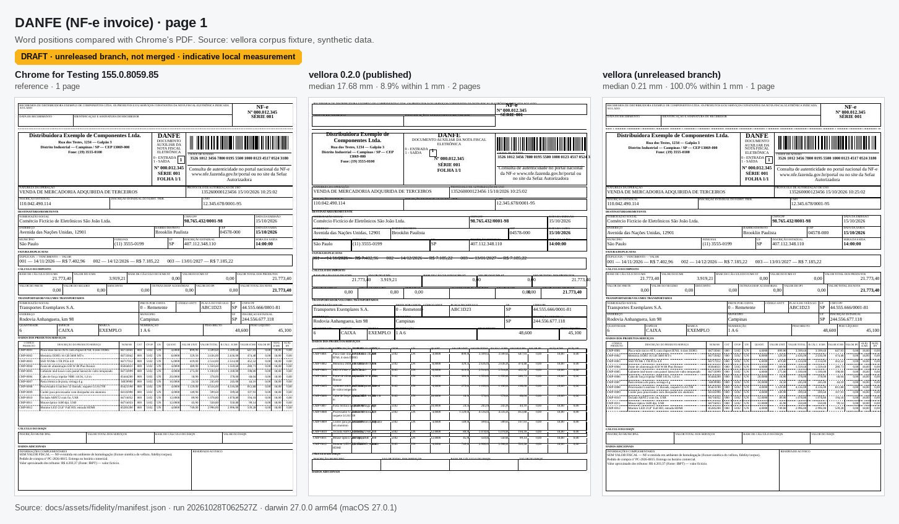

# vellora

**HTML to PDF for Node.js, rendered natively in your process. No browser to install or launch.**

[](https://github.com/diomalta/vellora/actions/workflows/ci.yml)


[](https://www.npmjs.com/package/vellora)

vellora turns the HTML your application generates (invoices, receipts, statements, boletos,
notices) into PDF through a native napi-rs addon. The default path installs no Puppeteer,
Playwright, Chromium or sidecar service. An optional Chromium engine is there for the templates
that need browser print output.

<!-- fidelity-evidence:readme-hero -->


| Measured against Chrome for Testing 155 print-to-PDF, 9 document fixtures | vellora 0.2.0 | vellora 0.3.0 |
|---|---:|---:|
| Fixtures with every word within 1 mm of Chrome's position | 0 of 9 | 8 of 9 |
| Largest per-fixture median word-position error | 106.22 mm | 0.21 mm |
| Fixtures that print the same number of pages as Chrome | 6 of 9 | 9 of 9 |
| WPT reftests passed (CSS subset coverage, not a quality score) | 2,578 of 8,047 | 4,553 of 8,047 |

<sub>Released in vellora 0.3.0; indicative local macOS measurement. Source: [manifest.json](./docs/assets/fidelity/manifest.json), method in [Measured fidelity](#measured-fidelity).</sub>
<!-- /fidelity-evidence:readme-hero -->

## Why vellora

- **In-process and native.** `renderPdf()` lays out and writes the PDF inside your Node.js
  process: Blitz for layout, krilla for PDF output, behind one async call on the libuv thread
  pool. There is no browser to install, launch, keep warm or patch.
- **Deterministic bytes.** The same input gives a byte-identical PDF. There is no wall clock (an
  omitted creation date is a fixed constant), no randomness and no host-font fallback. In a
  cross-OS check of the fidelity harness on a pre-release 0.3.0 tree, the PDFs were
  byte-identical on macOS arm64 and Linux arm64, including all 9 document fixtures and the PDF/A
  renders; x86_64 was not part of that check
  ([Cross-OS check](https://diomalta.github.io/vellora/guide/fidelity#cross-os-check)).
- **Strict mode rejects instead of mis-rendering.** By default, input outside the documented
  subset (scripts, form controls, `transform`, `display: grid`, unsupported `@page` margin boxes,
  and so on) is rejected before any PDF is written, with a `VelloraUnsupportedError` that carries
  `feature`, `line`, `col` and a `hint`. Strict mode never changes your HTML; `{ strict: false }`
  opts into the dev-time fixers instead.

## Install

```bash
npm install vellora
```

Prebuilt native addons are published for macOS arm64 and x64, and Linux glibc x64 and arm64. No
Rust toolchain is needed. musl/Alpine and Windows prebuilds are not published yet. vellora
requires Node.js 20 or later.

## Quick start

```ts
import { renderPdf } from "vellora";

const pdf = await renderPdf(invoiceHtml, data, {
  metadata: { title: "Invoice INV-2026-00417", creationDate: "2026-06-23T00:00:00.000Z" },
  strict: true,
});
```

`invoiceHtml` is a template: `{{ value }}`, ``, `` and the `currency`, `number`
and `date` helpers are filled from `data` before rendering. The result is a `Uint8Array`. See
[Getting started](https://diomalta.github.io/vellora/guide/getting-started) for a complete first
PDF.

## What's new in 0.3.0

- The native renderer runs on Blitz 0.3.0-beta.4 from crates.io, without a fork. Its output is
  measured word by word against Chrome for Testing 155, and the release was gated by a strict
  oracle contract.
- Floats are laid out. 0.2.0 compiled Blitz without its `floats` feature, so floats rendered as
  in-flow blocks.
- Multi-column layout, ruby annotations, `break-after` / `break-before`, and tables fragmented
  across pages.
- Table captions and anonymous table boxes.
- Inline `<svg>` drawn natively as PDF vectors. External `<image>` sources are rejected, and SVG
  layout never reads host fonts.
- Painting: the canvas background fills every page, and dashed and dotted borders and link
  underlines are drawn.
- Compensations for documented Blitz bugs, each with a code comment and a canary test so it can
  be removed when Blitz fixes the bug.

The cost: inline SVG support makes the native addon larger (see [Performance](#performance)).
Full notes: [GitHub Release v0.3.0](https://github.com/diomalta/vellora/releases/tag/v0.3.0).

## Measured fidelity

How close the native PDF lands to Chrome's print-to-PDF output for the same HTML, measured word by
word on the repo's document fixtures. Before is vellora 0.2.0; after is vellora 0.3.0. The block
below is generated from [manifest.json](./docs/assets/fidelity/manifest.json) by
`fidelity/report/build-site-evidence.mjs`, so it cannot drift from the measurement.

<!-- fidelity-evidence:readme -->
> **Released in vellora 0.3.0.** The measured run passed the strict merge gate (verdict PASS, --contract). INDICATIVE: local macOS measurement. The authoritative run is pinned Linux CI, which is not wired yet; these numbers will be regenerated from it when it runs. Before is vellora@0.2.0, the previous release.

Measured against Chrome for Testing 155.0.8059.85 headless print-to-PDF on 9 document fixtures, comparing the position of every word in each PDF:

- **8 of 9 fixtures** have every word within 1 mm of its position in Chrome for Testing 155.0.8059.85's PDF (share of word positions within 1 mm = 100%). vellora 0.2.0 (published): 0 of 9.
- **0.21 mm or less** median word-position error on every one of the 9 fixtures (largest: danfe). vellora 0.2.0 (published): up to 106.22 mm (text-stress-ptbr).
- **9 of 9 fixtures** print the same number of pages as Chrome. vellora 0.2.0 (published): 6 of 9.
- **4,553 of 8,047 WPT reftests** pass through the same pipeline (56.58%), coverage of the CSS test subset the harness runs, not a document-quality score. vellora 0.2.0 (published) engine: 2,578 (32.04%).

Method, the full table with the losses, and how to reproduce it: [Measured fidelity](https://diomalta.github.io/vellora/guide/fidelity#measured-fidelity). Raw values: [manifest.json](./docs/assets/fidelity/manifest.json).
<!-- /fidelity-evidence:readme -->

Known gaps: a multi-column container taller than a page is not split across pages, and `outline`
is not painted ([issue #48](https://github.com/diomalta/vellora/issues/48)). That gap is also why
the merge gate carries one WPT test as recorded debt: 0.2.0 passed
`flex-fragmented-with-float-descendant-001` cleanly, and 0.3.0 passes it with a suspect-pass flag.
Every loss the gate let through is listed in
[Measured fidelity](https://diomalta.github.io/vellora/guide/fidelity#losses-and-open-items), and
the per-feature caveats are in [COMPATIBILITY.md](./COMPATIBILITY.md).

## Supported HTML and CSS

vellora is not a browser. It targets generated documents whose markup you control. The full,
generated reference is [COMPATIBILITY.md](./COMPATIBILITY.md); in short:

- Block and inline text, headings and lists; tables, including repeated `<thead>` across pages,
  table captions and anonymous table boxes.
- `@page` size and margins, `counter(page)` / `counter(pages)`, running headers and footers in
  `@top-center` and `@bottom-center`, `@page :first` / `:left` / `:right`, named pages.
- `break-inside: avoid`, `break-before` and `break-after` (and the legacy `page-break-*` forms).
- Floats, multi-column layout (`columns`, `column-count`, `column-width`, `column-gap`,
  `column-fill`) and ruby annotations, each with the partial-support caveats listed in
  COMPATIBILITY.md.
- Inline `<svg>` as PDF vector content, with `<text>` set in the bundled or supplied fonts.
- PNG, JPEG, GIF and WebP images from data URLs or the `images` option; custom TTF/OTF faces from
  the `fonts` option.
- Selectable text with embedded font subsets, document metadata, and PDF/A-2b output.
- `display: flex` is accepted but partial; prefer tables for layout you rely on.

Rejected by the strict gate: JavaScript and `<script>`, form controls, `<canvas>`, media,
`<iframe>` / `<object>` / `<embed>`, `transform`, `filter`, `animation`, `transition`,
`display: grid` (`vellora fix` converts the common table-cell case), and `@page` margin boxes other than top-center and
bottom-center. The renderer never fetches network assets: pass image and font bytes in.

## When to use the optional Chromium engine

Use `engine: "chromium"` for a template that needs something the native subset does not draw, such
as JavaScript, CSS grid layout, transforms or arbitrary web pages, or whose PDF must come from
Chrome's own print path. It launches a Chrome/Chromium executable you provide, with headless print-to-PDF,
and does not depend on Puppeteer or Playwright.

```bash
npm install vellora @vellora/engine-chromium
```

```ts
const pdf = await renderPdf(html, data, {
  engine: "chromium",
  chromium: { executablePath: "/path/to/chrome", timeoutMs: 30_000 },
});
```

`engine: "auto"` routes each template by a committed `vellora.fidelity.json` policy, so one
service can keep most templates native and send the rest to Chromium. See
[Rendering fidelity and engine strategy](https://diomalta.github.io/vellora/guide/fidelity).

## Performance

From [Resource Benchmarks run 40687532121](https://github.com/diomalta/vellora/actions/runs/40687532121)
on pinned Linux CI (marked authoritative by the harness), built from the `v0.3.0` commit
`c40b3c2`: AMD EPYC 7763, 4 cores, Linux x64, Node v22.23.4, 2026-10-28. The fixture is the
3-page invoice; RSS is the peak at 8 concurrent renders, and warm timings are over 50 renders.

| Path | Fresh install | Native addon (linux-x64-gnu) | External runtime | Peak RSS @8 | External RSS @8 | Cold start | Warm median / p95 |
|---|---:|---:|---:|---:|---:|---:|---:|
| Native `vellora` | 39.72 MB | 33.77 MB | N/A | 117.60 MB | N/A | 47.29 ms | 19.09 / 23.32 ms |
| Vellora Chromium | 39.74 MB | 33.77 MB | 412.28 MB | N/A | 6833.96 MB | 735.01 ms | 635.50 / 681.03 ms |

Install size grew. The figures this README quoted before,
[run 28302742627](https://github.com/diomalta/vellora/actions/runs/28302742627) (commit `050979c`,
2026-06-27, Node v22.23.0, 4 cores, pinned Linux CI), were a 28.93 MB fresh install and a warm
median / p95 of 17.47 / 17.96 ms for the native path. That run's artifact has expired, so its addon
size cannot be compared here; the 0.3.0 release notes attribute the addon growth to inline SVG
support.

Puppeteer and Playwright are in the benchmark artifact but are not quoted here: the run marks them
non-comparable for this fixture (`page count 1 != reference 3`). Method and harness:
[benchmarks/](./benchmarks/).

## Using from CommonJS

vellora ships as ESM. CommonJS projects (for example NestJS with `"module": "commonjs"`) can
`require("vellora")` on Node 20.19+ or 22.12+, where Node loads ES modules through `require()`. On
older Node versions, use `await import("vellora")` instead. In CommonJS:

- Use named imports (`import { renderPdf } from "vellora"`). The package has no default export.
- With TypeScript `moduleResolution: "node16"`, a CommonJS file cannot import vellora (TS1479).
  Use `"nodenext"` or `"node20"` (TypeScript 5.8+), or the classic `"node"` resolution.
- When bundling to CommonJS (esbuild, webpack), mark `vellora` and `@vellora/*` as externals. The
  native loader needs `import.meta.url`, which a CommonJS bundle does not provide.
- Node 22.12 prints a harmless `ExperimentalWarning` on `require()` of an ES module; later 22.x
  releases do not.

## Packages

| Package | Purpose |
|---|---|
| `vellora` | Public API (`renderPdf`, `renderPdfBatch`, `renderPdfToStream`), templating, orchestration |
| `@vellora/native` | Loads the prebuilt napi addon for the host platform |
| `@vellora/lint` | Dev-time `diagnose()` and `fix()`; never on the strict render path |
| `@vellora/cli` | `vellora render`, `lint`, `fix`, `doctor` and `fidelity` |
| `@vellora/engine-chromium` | Optional browser engine using a host-supplied Chrome/Chromium |

## Docs

- [Docs site](https://diomalta.github.io/vellora/)
- [Getting started](https://diomalta.github.io/vellora/guide/getting-started)
- [Rendering fidelity and engine strategy](https://diomalta.github.io/vellora/guide/fidelity)
- Blog: [Word by word against Chrome: measuring vellora's native PDFs](https://diomalta.github.io/vellora/blog/native-pdf-fidelity-blitz-beta4)
- Blog: [HTML to PDF in Node.js without Puppeteer or Chromium](https://diomalta.github.io/vellora/blog/html-to-pdf-nodejs-without-puppeteer)
- [COMPATIBILITY.md](./COMPATIBILITY.md) · [ARCHITECTURE.md](./ARCHITECTURE.md) ·
  [benchmarks/](./benchmarks/) · [RELEASING.md](./RELEASING.md) · [SECURITY.md](./SECURITY.md)

## License

MIT. See [LICENSE](./LICENSE).
